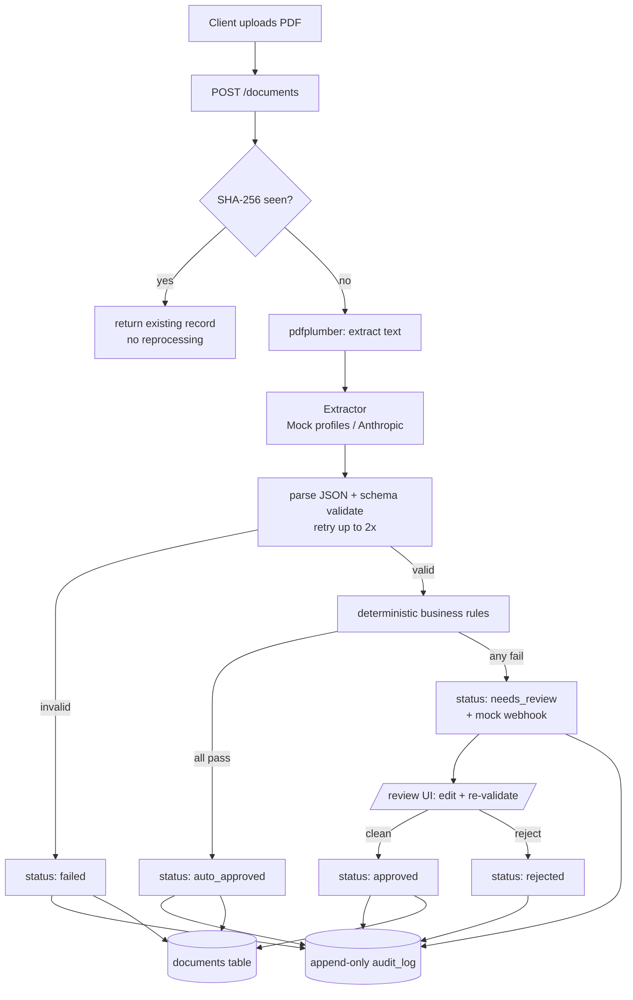

# doc-extraction-pipeline

A small, honest **document-to-structured-data service** for supplier invoices.
It ingests a PDF, extracts fields with an LLM, **validates them with
deterministic business rules**, **auto-approves** clean results, and routes
doubtful ones to a **human review queue** — with **idempotency**, an
**append-only audit log**, and **structured logging**.

The guiding principle: *use the LLM only for extraction; put every reliability
decision in deterministic code.*

It runs fully offline by default using a deterministic **mock extractor**, so
the whole pipeline is reproducible and needs no API key. A real **Anthropic**
extractor is included for an optional live suite.

> Portfolio project. See the [honest note](#honest-note) about scope and AI
> assistance. Every number below comes from a real run on my machine
> (`python -m docpipe evaluate` / `demo-failures`), not from imagination.

## Why this shape

- **Deterministic validation after the LLM.** LLMs are great at reading messy
  layouts but can't be trusted with money. So the model only proposes fields;
  arithmetic and policy checks (line items sum to net, net + VAT = gross, VAT
  matches the rate, date not in the future, currency allowed, invoice number
  present) are plain Python and are the source of truth.
- **Human-in-the-loop.** Anything a rule flags goes to a review queue instead of
  being trusted or silently dropped. Reviewer edits are **re-validated** before
  approval, so a human can't approve arithmetic that still doesn't add up.
- **Idempotency.** Invoices get re-sent (retries, duplicate emails). The SHA-256
  of the file content is the key; re-uploading the same bytes returns the
  existing record and does not process it twice.
- **Auditability.** Every state change is appended to an `audit_log` (who, what,
  when, before/after) — never updated in place.

## Architecture



## Quickstart

```bash
# 1. Install (creates .venv and installs the package + dev tools)
make install

# 2. Generate the 30 synthetic invoices + ground_truth.json
python -m docpipe generate

# 3. Evaluate the whole pipeline in deterministic mock mode
python -m docpipe evaluate --profile good      # writes reports/latest.{json,md}

# 4. Prove the validation layer catches bad extractions (exit 0 = all handled)
python -m docpipe demo-failures                 # writes docs/demo-failures.md

# 5. Run the API + review UI
python -m docpipe serve                          # http://127.0.0.1:8000
#   POST /documents (PDF upload), GET /documents, GET /documents/{id}
#   GET  /review (queue),         GET /health

# 6. Tests and lint
make test      # pytest -q
make lint      # ruff check .
```

### Production-like setup (Docker + Postgres)

```bash
docker compose up --build        # app on :8000, Postgres on :5432
```

The app reads `DATABASE_URL` (Postgres in compose, SQLite otherwise) and
`DOCPIPE_PROFILE`. **Not verified in this environment** — Docker was not
available where this project was built, so `docker compose up` has not been run
here. The compose file and Dockerfile are provided as-is.

### Optional: live mode (real model)

```bash
cp .env.example .env            # set ANTHROPIC_API_KEY (and optionally LLM_MODEL)
export ANTHROPIC_API_KEY=sk-ant-...
pytest -m live                  # runs the @live extractor test against the real API
```

If `ANTHROPIC_API_KEY` is unset the live test **skips automatically** and nothing
touches the network. Default model `claude-haiku-4-5-20251001` unless `LLM_MODEL`
overrides it. The key is read from the environment and is never logged or committed.

## Results (real mock run)

`python -m docpipe evaluate --profile good` over the 30 synthetic invoices
(full copy in [`docs/sample-report.md`](docs/sample-report.md)):

| Metric | Value |
|--------|-------|
| Field-level accuracy | **100.00%** (924/924 fields) |
| Auto-approved | 30 / 30 (100%) |
| Needs review | 0 |
| Failed | 0 |
| Mean JSON retries | 0.0 |
| **Wrongly auto-approved** | **0** |

### The validation layer catches bad extractions

`python -m docpipe demo-failures` (full table in
[`docs/demo-failures.md`](docs/demo-failures.md)):

| Profile | Injected failure | Auto-approved | Needs review | Failed | Wrongly auto-approved |
|---------|------------------|---------------|--------------|--------|-----------------------|
| `noisy` | misread / missing fields | 21 | 9 | 0 | **0** |
| `hallucinating` | invented wrong gross total | 18 | 12 | 0 | **0** |
| `malformed` | invalid JSON (survives retries) | 21 | 0 | 9 | **0** |

In every profile, **0 wrong values slipped through auto-approval** — each bad
extraction was either routed to review or marked failed, so `demo-failures`
exits `0`.

## Output schema

```
supplier_name, invoice_number, invoice_date (ISO), currency (EUR|USD|UAH|GBP),
line_items [{description, quantity, unit_price, line_total}],
net_total, vat_rate (fraction), vat_amount, gross_total
```

Prompt is versioned in [`prompts/extract_v1.txt`](prompts/extract_v1.txt).

## Project layout

```
src/docpipe/
  config.py        paths, statuses, tolerances, env
  schemas.py       pydantic contract (InvoiceExtraction, LineItem)
  models.py        SQLAlchemy ORM: Document, AuditLog
  db.py            engine/session/Base
  pdf.py           pdfplumber text extraction + SHA-256
  prompt.py        versioned prompt rendering
  extract/         base, mock (4 profiles), anthropic, factory
  validation.py    deterministic business rules
  routing.py       status decision
  pipeline.py      hash -> extract(+retry) -> validate -> route -> persist -> audit
  review.py        apply reviewer edits + re-validate
  audit.py         append-only audit writer
  webhook.py       mock needs_review notification (logged)
  logging_utils.py structured JSON logging + correlation id
  api.py           FastAPI app + /review Jinja UI
  invoices.py      synthetic invoice generator + ground truth
  eval.py          evaluation metrics + report
  __main__.py      CLI: generate / evaluate / demo-failures / serve
scripts/generate_invoices.py   thin wrapper around invoices.generate_all
tests/             unit (validation, retry, idempotency, routing, audit,
                   extractors) + API (TestClient) + end-to-end
```

## Limitations (read before trusting it)

- **No OCR.** Only text-based PDFs are supported (pdfplumber). Scanned / image
  invoices would need an OCR step that is not included.
- **The mock extractor is rule-based, not a model.** It parses invoices we
  generated ourselves, so the ground truth is aligned to it by construction.
  **100% mock accuracy measures the pipeline (validation, routing, idempotency,
  audit), not a real model's extraction quality.** Real-model numbers only come
  from the live suite, which was not run here.
- **Arithmetic-consistent hallucinations are not caught.** Validation catches
  numbers that don't add up. A hallucination that is internally consistent but
  factually wrong (e.g. a wrong supplier name) would pass the rules — that is a
  genuine gap, and why human review exists. `demo-failures` reports
  `wrongly_auto_approved` honestly for exactly this reason.
- **Number formatting is normalized** (dot decimals) across both English and
  German layouts; real invoices vary more (comma decimals, symbols, noise).
- **Docker/Postgres path was not verified here** (no Docker in the build env).

## Honest note

This is a **portfolio project** showing how I'd build a reliable document
pipeline: an LLM for the fuzzy part, deterministic code for everything that must
be trustworthy, plus idempotency, human review and an audit trail. It was built
with AI assistance (Claude Code). Every figure in this README came from a real
run on my machine; **no live-model results are included because the live suite
was not run** (no API key was set).

## License

MIT — see [LICENSE](LICENSE). Author: Anton Bryzhchuk.
